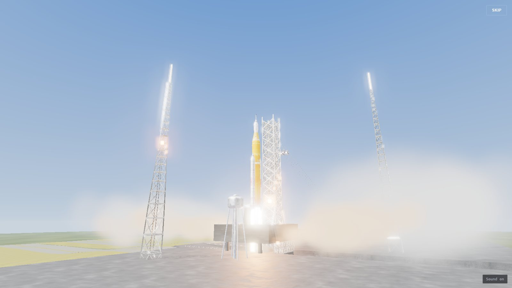
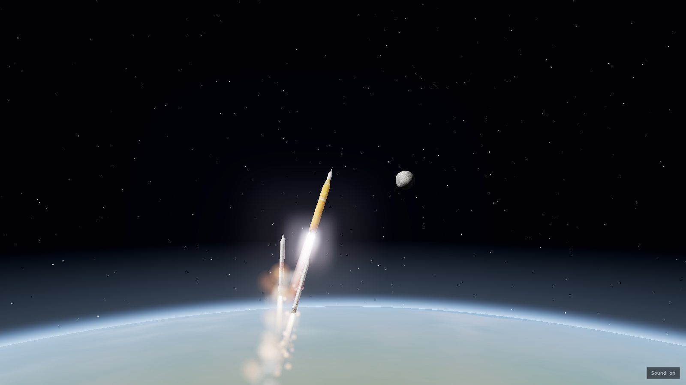
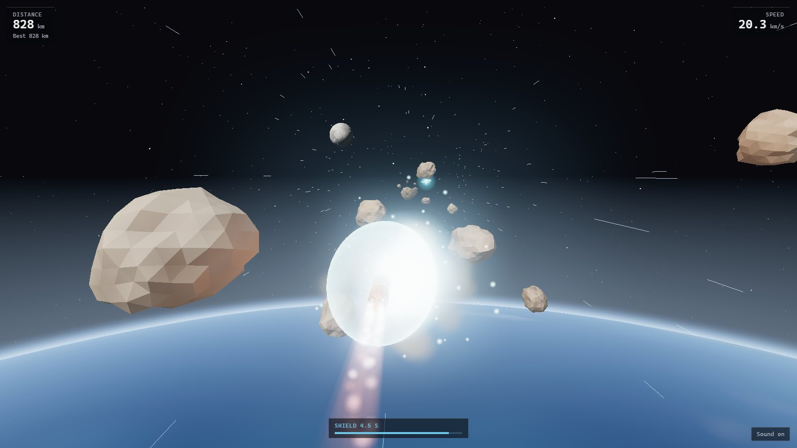

# Artemis II game

A browser game where you launch NASA's Artemis II rocket from the pad and then steer it through an asteroid field on the way to the Moon.


### **[▶ Play it in your browser](https://javinwittig.github.io/Artemis-2-game/)**

## Quick start

Open **https://javinwittig.github.io/Artemis-2-game/** and press **Start**. It runs on desktop and mobile. The first load fetches a 17 MB model, so give it a few seconds.

- **Desktop:** steer with `WASD` or the arrow keys
- **Mobile:** drag anywhere on the screen

## Features

- **A full launch sequence.** Countdown from 10 while the camera circles the pad, main engine start at T–3.5, booster ignition and liftoff at T–0, then a roll program as the sky fades to black. `Skip` fast-forwards it.
- **No cut between the cinematic and the game.** The rocket pitches over, the two boosters separate and tumble away, and the camera swings behind the rocket on one continuous arc.
- **Asteroids that get harder over time.** Every rock has a random shape, size and spin. More of them spawn as you fly, they get faster, and some aim straight at you. One hit ends the run.
- **Shield power-up.** Rare crystals give 5 seconds of shield. Asteroids that touch it shatter, and the shield blinks during its last second.
- **Score and best score.** Distance flown in km. Your best run is saved in the browser.
- **Instant restart.** `Try again` goes straight back into the asteroid field, and `Back to start` replays the full launch.

| Liftoff | Booster separation | Shield |
|---|---|---|
|  |  |  |

## Run it locally

Requires **Node.js 18 or newer** (tested with Node 24) and npm. There are no other dependencies and no environment variables.

```bash
git clone https://github.com/javinwittig/Artemis-2-game.git
cd Artemis-2-game
npm install
npm run dev
```

Then open the URL Vite prints (usually http://localhost:5173).

- **Production build:** `npm run build` writes a static site to `dist/`, and `npm run preview` serves it.
- **Without Vite:** after `npm install`, you can also open `index.html` with any static server, for example VS Code's Live Server. An import map in `index.html` resolves `three` from `node_modules/`.
- **Deployment:** every push to `main` is built and published to GitHub Pages by `.github/workflows/deploy.yml`.

| Key | Action |
|---|---|
| `WASD` / arrow keys | Steer |
| `Space` / `Enter` | Start, or try again after a crash |
| `R` | Try again |
| `L` / `Esc` | Back to the launch pad |
| `M` | Sound on/off |

## How it works

**The rocket model is split up at load time.** The game uses a single Blender export (`assets/Nasa_Rakete_small.glb`), and it wasn't built for animation. Both boosters are one mesh. The six engine nozzles belong to the launch tower mesh, not the rocket, and the whole stack floats about 200 units above the pad. `rocketModel.js` sorts triangles by their world-space position: nozzles are cut out of the tower, the booster mesh is split by side, and the stack is lowered onto the deck. The export uses quantized vertex attributes, so the parts aren't copied into new vertex buffers. Each part keeps the original buffers and only gets its own index list, which keeps the UVs and normals exactly as they were.

**One continuous camera.** Every phase (title orbit, countdown, ascent, pitch-over, chase) writes the same camera target, and each phase starts from the pose the previous one ended on. During the pitch-over, the camera offset relative to the rocket is spherically interpolated from "side and below" to "behind and above", so it swings around the rocket instead of passing through it. Automated tests measured at most 0.42° of camera rotation per frame across the whole hand-off.

**The Earth rolls under the rocket instead of the rocket flying away.** The launch site is attached to the north pole of a procedural Earth sphere, with a radius of 250,000 units. Once the rocket flies forward, the sphere moves along with it and rotates by the same arc length. The ground therefore scrolls past realistically, and the pad stays in place on the surface without anything drifting away from the origin. The continents, clouds and atmosphere glow are all GLSL shaders. The atmosphere is computed from the ray's closest approach to the planet, so the limb looks right at any altitude.

**Built to stay at 60 fps.** All particles (fire, smoke, steam, sparks) are camera-facing quads in three instanced draw calls, simulated on the CPU. Asteroids are six procedurally generated rock shapes, each drawn as one `InstancedMesh`. Collisions use a capsule along the rocket body (and an ellipsoid while the shield is up) instead of mesh tests. Every shader, including hidden effects, is compiled before the title screen, so nothing stutters on first use. Phones get a lower pixel ratio, no bloom, no shadows and fewer particles. If any device drops below ~45 fps, the game lowers the resolution and then turns bloom off.

Everything except the rocket model is generated in code: asteroids, power-ups, Earth, Moon, stars, particles and all sounds (Web Audio synthesis). Nothing is downloaded at runtime.

## Credits

- Rocket and launch pad model: my own Blender model of the Artemis II SLS and Orion.
- [three.js](https://threejs.org/) for rendering, glTF loading with meshopt decoding, and the bloom post-processing.
- [Vite](https://vite.dev/) for the dev server and build.
- The value-noise hash in the shaders follows [Inigo Quilez's](https://iquilezles.org/) widely used formulation.
- Inspired by NASA's [Artemis II mission](https://www.nasa.gov/mission/artemis-ii/). This is a fan project and is not affiliated with NASA.
