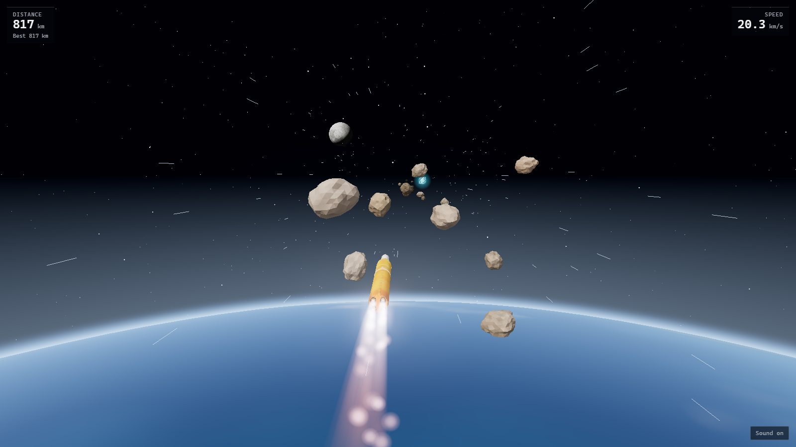

# Artemis 2 Game

I built a browser game where you launch NASA's Artemis II rocket from the pad and then steer it through an asteroid field on the way to the Moon.




###  Play it now in your browser: https://javinwittig.github.io/Artemis-2-game/


## Quick start

Open **https://javinwittig.github.io/Artemis-2-game/** and press **Start**. It runs on desktop and mobile. The first load needs a bit longer, so please give it a few seconds.

- **Desktop:** steer with `WASD` or the arrow keys
- **Mobile:** drag anywhere on the screen

## Features

First a countdown counts down from 10, then the rocket launches, the boosters separate from the rocket and the actual game starts.

As you dodge the asteroids, glowing crystals sometimes appear. Collecting one gives you a shield that protects you for 5 seconds.

When you die, you can instantly restart and don't need to rewatch the starting animation, which you can also skip if you want.

## Run it locally

Requires **Node.js 18 or newer** (tested with Node 24) and npm. Nothing else is required.

```bash
git clone https://github.com/javinwittig/Artemis-2-game.git
cd Artemis-2-game
npm install
npm run dev
```

Then open the URL Vite prints (usually http://localhost:5173).


## How it works

**I cut my rocket model apart when the game loads.** I modeled the rocket and launch pad in Blender. The two boosters were one object, the engine nozzles were part of the launch tower, and the rocket was hovering above the pad. Instead of rebuilding the model, the game sorts its pieces by position when it loads: it pulls the nozzles off the tower, splits the boosters into a left and a right one, and sets the rocket down on the pad. That's how the boosters can fall away during the flight. I was a bit messy in my Blender scene.

**The camera never cuts.** The intro and the game use the same camera. When the countdown ends, it follows the rocket up, then turns around behind it once the rocket tips over. You go from the launch straight into the actual game without a loading screen. Waiting between scenes annoys me in other games, so it was important to me that this one doesn't have any.

**The Earth moves, not the rocket.** Rockets fly fast, and 3D graphics get glitchy far away from the center of the scene, so the rocket stays roughly in place and the Earth turns underneath it. The launch pad sits on top of a big globe, and as you fly, the globe rolls away below you until you only see its curved edge.

**It's built to run smoothly on phones too.** Fire, smoke and asteroids are drawn in large batches instead of one by one. Hits are checked with simple shapes instead of the exact model. Everything is prepared before you press Start, so the game doesn't stutter when an effect shows up for the first time. Phones get fewer effects, and if any device starts to lag, my game lowers the quality on its own.

Apart from my rocket model, which I made in Blender, everything was made in code: the asteroids, the Earth and Moon, the stars, the fire and smoke, and even the sounds.

## Credits

- Rocket and launch pad model: my own Blender model of the Artemis II SLS and Orion.
- [three.js](https://threejs.org/) for rendering, glTF loading with meshopt decoding, and the bloom post-processing.
- [Vite](https://vite.dev/) for the dev server and build.
- The value-noise hash in the shaders follows [Inigo Quilez's](https://iquilezles.org/) widely used formulation.
- Inspired by NASA's [Artemis II mission](https://www.nasa.gov/mission/artemis-ii/). This is a fan project and is not affiliated with NASA.

# I hope you enjoyed playing my game
